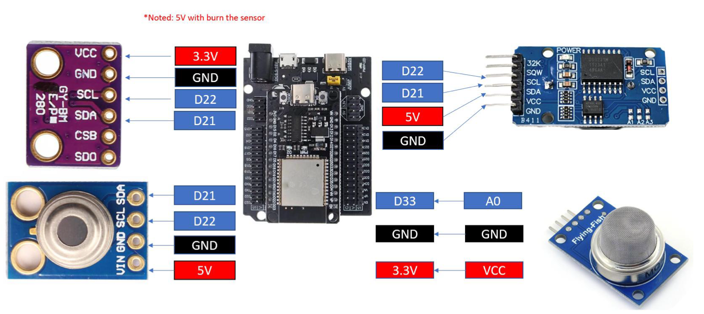
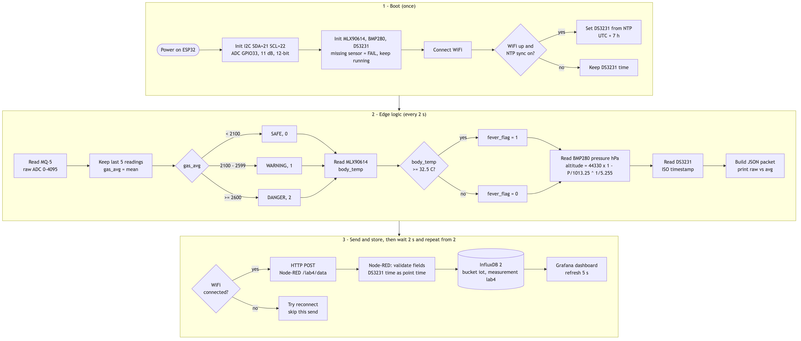
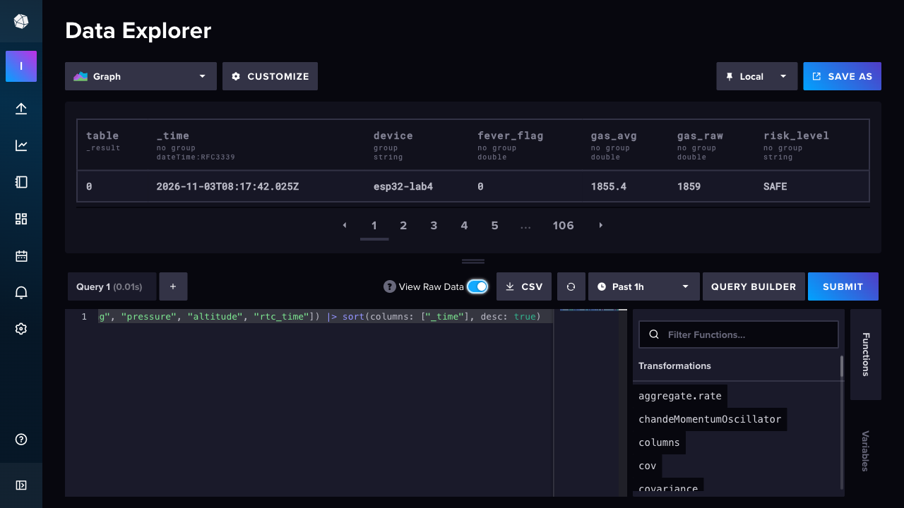
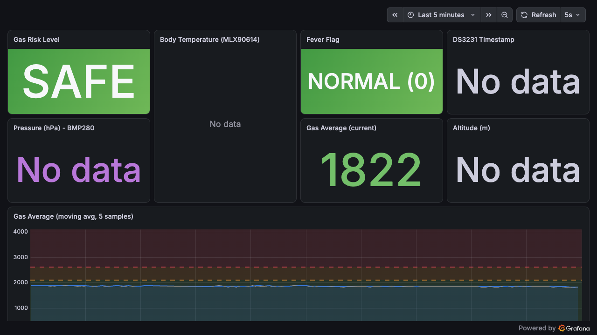

# Lab 4: Multi-Sensor IoT Monitoring with Grafana Dashboard

ESP32 (MicroPython) reads four sensors, runs edge logic on the board, and sends one JSON packet every 2 s to Node-RED. Node-RED stores it in InfluxDB 2 and Grafana shows it on a live dashboard.

```
MQ-5 / MLX90614 / BMP280 / DS3231 -> ESP32 (edge logic) -> HTTP POST -> Node-RED -> InfluxDB 2 -> Grafana
```

## Equipment
- ESP32 development board (MicroPython firmware flashed)
- MLX90614 infrared thermometer (body temperature)
- MQ-5 gas sensor (analog)
- BMP280 (room temperature, pressure, altitude)
- DS3231 real-time clock
- Breadboard and jumper wires
- USB cable and laptop with Thonny
- Wi-Fi access, Node-RED, InfluxDB 2, Grafana

## Wiring


| Sensor | Pins | ESP32 |
|--------|------|-------|
| BMP280 | VCC / GND / SCL / SDA | 3.3V / GND / D22 / D21 |
| MLX90614 | VIN / GND / SCL / SDA | 5V / GND / D22 / D21 |
| DS3231 | VCC / GND / SCL / SDA | 5V / GND / D22 / D21 |
| MQ-5 | VCC / GND / A0 | 3.3V / GND / D33 |

All I2C sensors share one bus (SDA = GPIO21, SCL = GPIO22, 100 kHz). Addresses: MLX90614 `0x5A`, BMP280 `0x76`/`0x77`, DS3231 `0x68`. The BMP280 must stay on 3.3V; 5V will burn the sensor.

## Files

| Path | Description |
|------|-------------|
| `main.py` | MicroPython program: sensors, edge logic, JSON packet, HTTP POST |
| `config.example.py` | Wi-Fi, Node-RED URL and timezone. Copy it to `config.py` |
| `lib/mlx90614.py`, `lib/bmp280.py`, `lib/ds3231.py` | Sensor drivers (upload to `/lib` on the ESP32) |
| `node-red/flows.json` | Node-RED flow export |
| `grafana/dashboard.json` | Grafana dashboard (InfluxDB Flux queries) |
| `docs/flowchart.png` | System flowchart (`docs/flowchart.mmd` is the Mermaid source) |
| `tools/` | Setup scripts, sensor simulator and demo recorder |
| `evidence/` | Screenshots and demo video |

## Setup Instructions

### 1. Server side (laptop)
```bash
brew install influxdb@2 influxdb-cli grafana
npm install -g node-red
brew services start influxdb@2
brew services start grafana
cd ~/.node-red && npm install node-red-contrib-influxdb
node-red
```
- InfluxDB: `influx setup` with org `lab4` and bucket `iot`. Copy `.env.example` to `.env` and fill in the password and token.
- Node-RED: import `node-red/flows.json` (or run `python3 tools/deploy_nodered.py`). Then set the InfluxDB token in the **Local InfluxDB 2** config node.
- Grafana: run `python3 tools/setup_grafana.py` to create the InfluxDB datasource and the dashboard. It opens at `http://localhost:3000/d/lab4-iot`.

### 2. ESP32
- Install MicroPython on the ESP32.
- Copy `config.example.py` to `config.py` and set the Wi-Fi name and password. Set `NODE_RED_URL` to the laptop's IP (`ipconfig getifaddr en0`).
- Upload `lib/*.py` to `/lib` on the ESP32. Upload `config.py` and `main.py` to `/`.
```bash
mpremote fs mkdir :lib
mpremote fs cp lib/mlx90614.py lib/bmp280.py lib/ds3231.py :lib/
mpremote fs cp config.py main.py :
mpremote reset
```
- Reset the ESP32 and check the Serial Monitor. At boot it prints the I2C scan, `[ok]`/`[FAIL]` for each sensor and the IP address.
- At boot the DS3231 is set from NTP (UTC+7) when Wi-Fi is up.

### Testing without the board
`python3 tools/simulate.py` runs the same edge logic as `main.py` on fake readings. It cycles through SAFE → WARNING → DANGER and normal → fever, and posts to Node-RED as device `simulator`.

## System Logic


Every 2 seconds the ESP32 does the following:
1. **Gas filtering:** reads MQ-5 on the 12-bit ADC (0–4095), keeps the last 5 readings, and computes `gas_avg`.
2. **Gas risk:** `gas_avg < 2100` → `SAFE` (0), `2100–2599` → `WARNING` (1), `≥ 2600` → `DANGER` (2).
3. **Fever detection:** `body_temp ≥ 32.5 °C` → `fever_flag = 1`, otherwise `0`.
4. **Pressure and altitude:** BMP280 pressure in hPa. Altitude = `44330 × (1 − (P / 1013.25)^(1/5.255))` m.
5. **Timestamp:** read from the DS3231 as ISO 8601 (`2026-11-03T15:00:00+07:00`).

If a sensor is missing, the program keeps running and sends `null` for that sensor's values.

JSON packet sent to `POST http://<pc-ip>:1880/lab4/data`:
```json
{
  "device": "esp32-lab4",
  "gas_raw": 1866, "gas_avg": 1855.2, "risk_level": "SAFE", "risk_code": 0,
  "body_temp": 31.42, "ambient_temp": 29.1, "fever_flag": 0,
  "room_temp": 30.55, "pressure": 1009.61, "altitude": 30.5,
  "timestamp": "2026-11-03T15:00:00+07:00"
}
```
In Node-RED, the function node keeps only valid numeric fields and stores `timestamp` as the `rtc_time` field. It writes the point to InfluxDB (bucket `iot`, measurement `lab4`, tag `device`). The DS3231 time becomes the point's time when it is within 10 minutes of the server clock.

## Task 1 : Gas Filtering (Moving Average)
- Read MQ-5 using ESP32 ADC (12-bit).
- Store the last 5 readings.
- Compute moving average.
- Print raw and averaged value.
- Send averaged value to Node-RED.
### Evidence


## Task 2 : Gas Risk Classification
- `< 2100` → SAFE
- `2100–2599` → WARNING
- `≥ 2600` → DANGER
- Send `risk_level` with data packet.
### Evidence


## Task 3 : Fever Detection Logic
- If `body_temp ≥ 32.5 °C` → `fever_flag = 1`
- Else → `fever_flag = 0`
- Send `fever_flag` to Node-RED.
### Evidence


## Task 4 : Pressure & Altitude Monitoring (Grafana)
Panels: Gas Average (time series), Risk Level, Body Temperature gauge, Fever Flag, Pressure graph and current hPa, Altitude graph and current m, DS3231 timestamp, Body vs Room temperature.
### Evidence
InfluxDB data:



Grafana dashboard:



## Demo Video
[Demo video (78 s)](evidence/demo.mp4)
